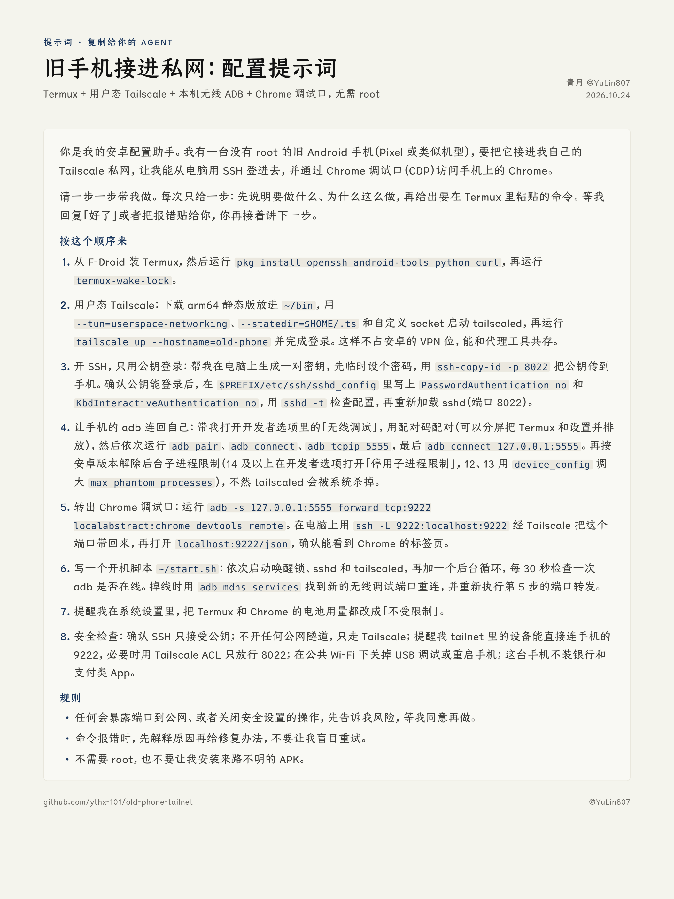
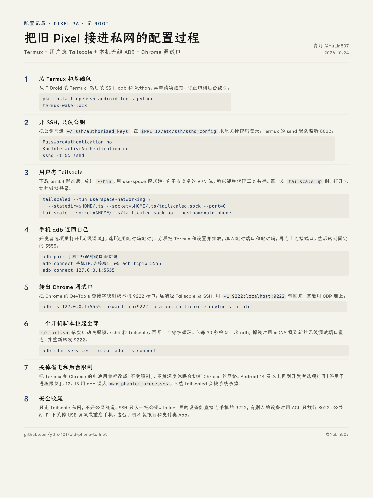

# old-phone-tailnet · 旧手机接进私网

把抽屉里**没有 root** 的旧安卓手机，变成你 Tailscale 私网里一台能 `ssh` 登录、能用 CDP（Chrome DevTools Protocol）远程操控 Chrome 的小节点：不 root、不占安卓 VPN 位、不暴露公网。适合想复用旧手机、要真机 Chrome 跑浏览器自动化（Playwright / Puppeteer）、或在用 Claude Code 的人。

> English: turn a spare non-rooted Android phone into a private node on your Tailscale tailnet, using Termux and userspace Tailscale: SSH in with public keys only, and drive the phone's Chrome over the Chrome DevTools Protocol (CDP) from Playwright or Puppeteer. Includes a copy-paste prompt and a Claude Code skill.

**Termux + 用户态 Tailscale + 只认公钥的 SSH + 本机无线 ADB + Chrome 调试口**



## 快速开始（5 步）

需要准备：Android 11 或更新的手机（无线调试从 11 开始才有），连着 Wi-Fi；从 F-Droid 装的 Termux；一台装好 Tailscale 的电脑。

手机端脚本用 `curl -fsSLO https://raw.githubusercontent.com/ythx-101/old-phone-tailnet/main/skills/old-phone-tailnet/scripts/<脚本名>` 下载到 Termux 里。

1. 手机装 Termux 和基础包：`pkg update -y && pkg install -y openssh android-tools python curl`，再运行 `termux-wake-lock`。
2. 手机上运行 `install-tailscale.sh`，按 SKILL.md 第 2 步拉起 tailscaled，再 `~/bin/tailscale --socket=$HOME/.ts/tailscaled.sock up --hostname=old-phone` 登录。
3. 手机上 `passwd` 后运行 `sshd`，电脑上 `ssh-copy-id -p 8022 <用户名>@<手机的 100.x 地址>` 传公钥，确认能免密登录后在手机上运行 `bash harden-ssh.sh`。
4. 打开「无线调试」配对（SKILL.md 第 4 步），然后在手机上运行 `bash start.sh <IP>:<端口>`。
5. 电脑上运行 `bash pc-connect.sh <手机地址>`，另开终端运行 `curl http://localhost:9222/json`。

每一步的详细说明和报错处理见 [SKILL.md](skills/old-phone-tailnet/SKILL.md)。

**跑通后是什么样**
- 手机上运行 `bash check.sh`，每项都是 `[OK]`；
- 电脑上 `curl http://localhost:9222/json` 能列出手机 Chrome 的标签页；
- Playwright 用 `chromium.connectOverCDP("http://localhost:9222")` 连上，Puppeteer 用 `puppeteer.connect({browserURL: "http://localhost:9222"})`。

## 三种用法，挑一种

### 1. 复制提示词（最简单）
把 [prompt.md](prompt.md) 整段贴给任何一个 AI 助手（Claude、ChatGPT、DeepSeek、豆包都行），它会一步一步带你配完。

### 2. 装成 Claude Code skill
```bash
git clone https://github.com/ythx-101/old-phone-tailnet
mkdir -p ~/.claude/skills
cp -r old-phone-tailnet/skills/old-phone-tailnet ~/.claude/skills/
```
然后在 Claude Code 里说「帮我把旧手机接进私网」。SSH 打通之前它带你一步步在 Termux 里操作；打通以后，它可以直接替你跑自检。

### 3. 自己照着脚本做
| 脚本 | 在哪跑 | 做什么 |
|---|---|---|
| `install-tailscale.sh` | 手机 Termux | 下载 Tailscale 官方最新静态版到 `~/bin` |
| `harden-ssh.sh` | 手机 Termux | 关闭密码登录，只认公钥（会先检查公钥已经放好） |
| `start.sh` | 手机 Termux | 一键拉起唤醒锁、sshd、Tailscale，并启动 adb 掉线重连和 9222 转发 |
| `check.sh` | 手机 Termux | 只读自检：SSH、Tailscale、adb、9222、公网隧道 |
| `pc-connect.sh` | 电脑 | 经 Tailscale 把手机的 9222 转发到电脑本机 |

完整步骤见 [SKILL.md](skills/old-phone-tailnet/SKILL.md)。



## 为什么这么配
- **用户态 Tailscale**：不占安卓唯一的 VPN 位，能和代理工具同时开。
- **adb 连回自己**：不用 root，也能在手机上用 adb，转发 Chrome 的调试套接字。
- **只走私网**：SSH 和 9222 都不暴露到公网，只有你 Tailscale 里的设备能连。

## 和其他方案比
只比定性区别：

| 方案 | 要 root | 占 VPN 位 | 暴露公网 | 能从电脑控制手机 Chrome |
|---|---|---|---|---|
| 本项目（用户态 Tailscale + SSH + 本机 adb） | 否 | 否 | 否 | 能（CDP） |
| 手机上直接装 Tailscale 官方 App | 否 | 占 | 否 | 本身不提供 SSH / CDP |
| ngrok / frp / cloudflared 公网隧道 | 否 | 否 | 是（本项目不推荐，`check.sh` 会检查这类进程） | 要自己配 |
| USB 线连电脑 adb | 否 | 否 | 否 | 手机得一直插在电脑上 |
| root 方案 | 要（解锁 bootloader / root） | — | — | 能，但代价大 |

**适合**：
- 有闲置的 Android 11+ 旧手机；
- 想要一台真机 Chrome 给 Playwright / Puppeteer 用；
- 手机要和代理工具同时开着。

**不适合**：拿日常主力机、装了银行和支付 App 的手机。能 SSH 进来的人也能操作手机上已经登录的网页，见下面「安全」。

## 安全
能 SSH 进这台手机的人，也能通过 adb 和 Chrome 调试口操作它，包括手机上已经登录的网页。所以：
- 私钥保管好，SSH 只认公钥；
- 不开公网隧道，只走 Tailscale；
- **注意**：用户态 Tailscale 会把发到手机 100.x 的连接转给手机本机，tailnet 里的设备不用 SSH 就能直接连 `100.x:9222`。tailnet 里有别人的设备时，用 Tailscale ACL 只放行 8022（示例见 [SKILL.md](skills/old-phone-tailnet/SKILL.md) 第 8 步）；
- `adb tcpip 5555` 会在 Wi-Fi 上监听 5555，只关「无线调试」不一定关得掉。在公共 Wi-Fi 下请关掉「USB 调试」或重启手机；
- 最好用一台专门的旧手机，不装银行和支付类 App。

## 已知限制
- 重启手机后「无线调试」会自动关掉，需要手动打开一次，再运行 `bash start.sh <IP>:<端口>`。
- userspace 模式下，手机上的其他 App 不能主动访问私网里的其他机器，但从外面连进手机不受影响。
- Android 12 起系统会杀 Termux 的后台子进程，要按 SKILL.md 第 4 步解除限制。
- 不同品牌的系统省电策略不一样。如果 Termux 老被杀，在系统设置里把它加进省电白名单，并在多任务界面锁住它。

## FAQ

### Q: 需要 root 吗？(Does it need root?)
不需要。全程在 Termux 里完成，adb 是手机连回它自己。

### Q: 和直接装 Tailscale 安卓 App 有什么区别？(userspace vs. the Tailscale app)
这里用用户态（userspace）Tailscale，不占安卓唯一的 VPN 位，能和代理工具同时开。代价是手机上的其他 App 不能主动访问私网里的其他机器，但从外面连进手机不受影响。

### Q: 支持哪些安卓版本？(Which Android versions?)
Android 11 或更新，因为无线调试从 11 开始才有。Android 12 起系统会杀 Termux 的后台子进程，要按 SKILL.md 第 4 步解除限制。

### Q: 手机重启以后怎么办？(After a reboot?)
重启后「无线调试」会自动关掉。重新打开它，然后运行 `bash start.sh <IP>:<端口>`。想开机自动运行，可以装 Termux:Boot，步骤见 SKILL.md 第 6 步。

### Q: 安全吗？tailnet 里别人能连 9222 吗？(Is it safe? Can others on my tailnet reach port 9222?)
SSH 只认公钥，也不开公网隧道。但用户态 Tailscale 会把发到手机 100.x 的连接转给手机本机，所以 tailnet 里的设备不用 SSH 就能直接连 `100.x:9222`。tailnet 里有别人的设备时，用 Tailscale ACL 只放行 8022，见上面「安全」和 SKILL.md 第 8 步。

### Q: 能用 Playwright / Puppeteer 控制手机 Chrome 吗？(Playwright / Puppeteer over CDP?)
能。先用 `pc-connect.sh` 把 9222 转发到电脑本机，然后：
```js
// Playwright
const browser = await chromium.connectOverCDP("http://localhost:9222");
// Puppeteer
const browser = await puppeteer.connect({browserURL: "http://localhost:9222"});
```

### Q: Windows 电脑能用吗？(Does it work from a Windows PC?)
能。SKILL.md 第 3 步写了 PowerShell 版传公钥的命令。`pc-connect.sh` 是 bash 脚本，Windows 上直接用 SKILL.md 第 5 步那条转发命令：`ssh -p 8022 -N -L 9222:localhost:9222 <用户名>@<手机的 100.x 地址>`。

### Q: 不用 Claude Code 能用吗？(Without Claude Code?)
能。把 [prompt.md](prompt.md) 贴给任意 AI 助手，或者照上面的脚本表自己做。

## License
MIT · 青月 [@YuLin807](https://x.com/YuLin807)
